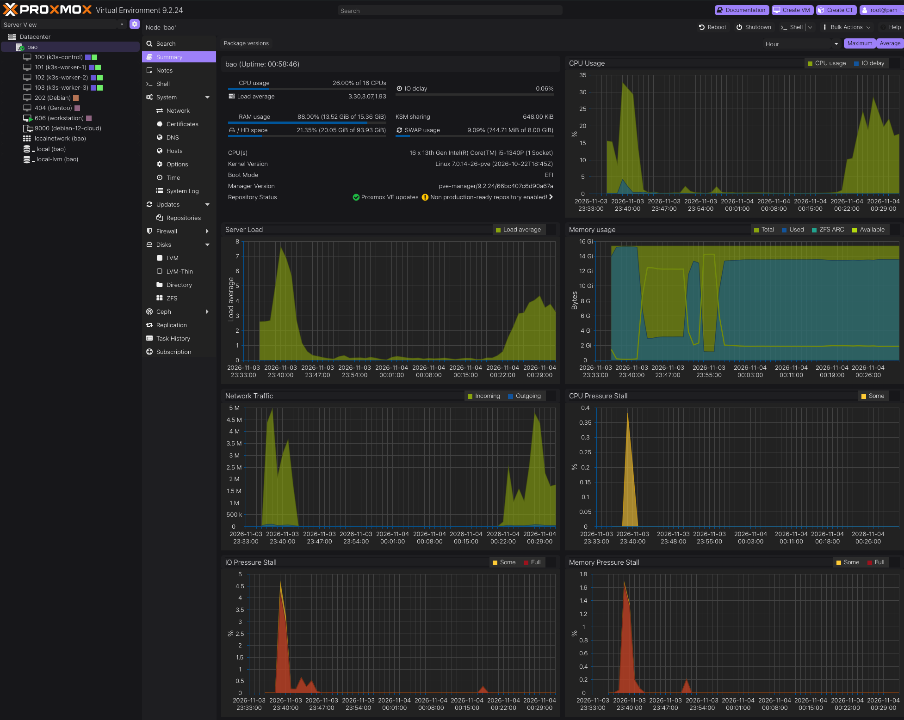
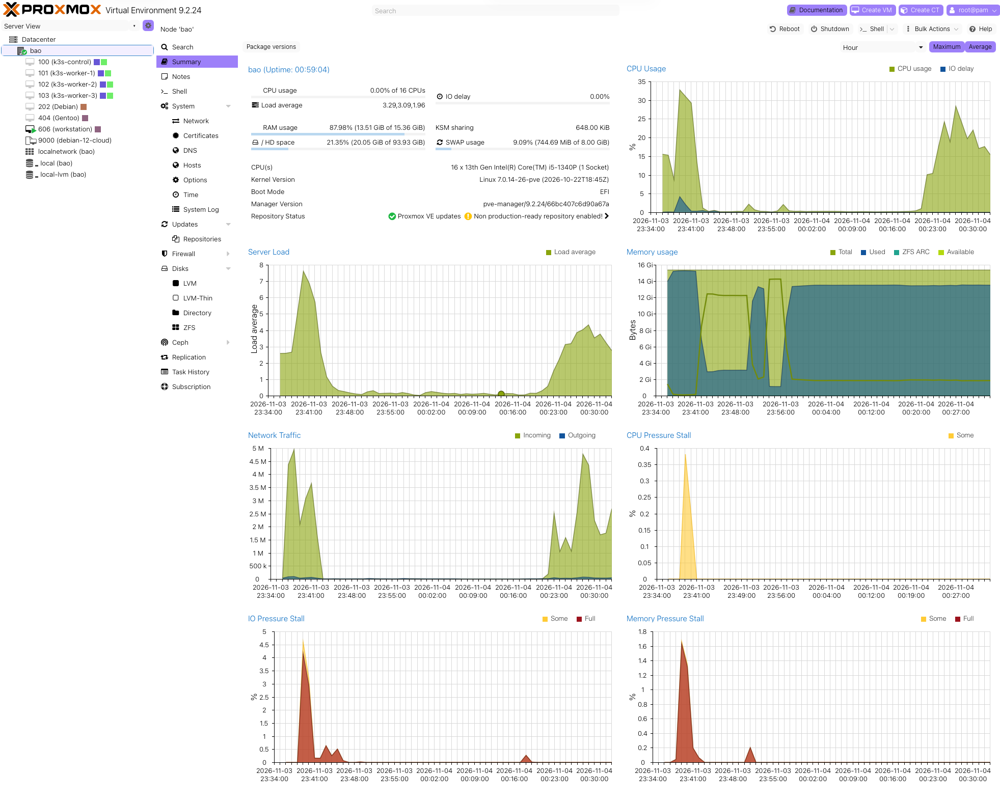

# Proxmox VE Theme

A flat light and dark theme with purple accents for the Proxmox VE web interface.

## Overview

Matching light and dark color schemes with consistent buttons, selections, form
controls, and automatic switching based on the operating system's preference.

## Screenshots

**Dark theme**



**Light theme**



## Files

Theme files are in `themes/pve/`:

- `80pvecustomcss-hook` — package hook
- `custom.css` — light styles
- `custom-dark.css` — dark styles for Proxmox Dark and automatic dark mode
- `index.html.tpl` — template override
- `pve-custom-css-restore` — restore script
- `RESTORE.md` — documentation

## Apply the theme

Back up any existing custom theme files, then run the following as `root` on the
Proxmox host from the `themes/pve/` directory:

```sh
install -m 0644 custom.css custom-dark.css /usr/share/pve-manager/css/
install -m 0644 index.html.tpl /usr/share/pve-manager/index.html.tpl
install -m 0755 pve-custom-css-restore /usr/local/sbin/pve-custom-css-restore
install -m 0644 80pvecustomcss-hook /etc/apt/apt.conf.d/80pvecustomcss-hook
systemctl restart pveproxy
```

Refresh the Proxmox web interface, then select **Proxmox Dark** in the theme
settings to use dark mode. Select **Auto** to follow the operating system's
light/dark preference. The package hook restores the custom stylesheet links
after Proxmox updates.
